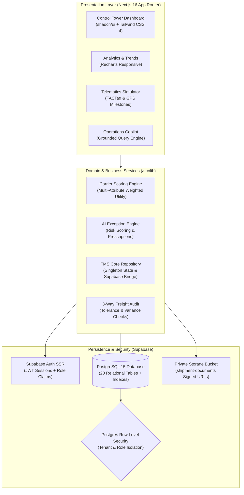

# TransitIQ — AI-First Transportation Management System (TMS)

[](https://nextjs.org/)
[](https://react.dev/)
[](https://www.typescriptlang.org/)
[](https://tailwindcss.com/)
[](https://supabase.com/)
[](https://vitest.dev/)

> **TransitIQ** is a production-grade, AI-first Transportation Management System designed specifically for Indian logistics companies, third-party logistics providers (3PLs), industrial manufacturers, and FMCG distributors.
> 
> **Core Operating Philosophy:** *Shift from reactive shipment tracking to proactive, AI-assisted transportation operations.*

---

## 🎯 Executive Summary & Vision

Traditional TMS platforms in India function as passive record-keeping tools: dispatchers react to delays only after drivers call or customers complain about missed delivery windows. 

**TransitIQ transforms this paradigm by connecting every layer of transportation into an autonomous, proactive operational loop:**
- **Order Consolidation & Load Optimization:** Unplanned orders are dynamically matched against truck volumetric capacities (32ft Multi-Axle, 24ft Taurus, 14ft Eicher, Tata Ace) to prevent empty backhauls and overweight penalties.
- **Intelligent Carrier Procurement:** Dynamic multi-attribute scoring model (Cost 35%, On-Time Performance 30%, Capacity Suitability 15%, Damage/Incident History 10%, Lane Experience 10%) ranks logistics partners transparently with verifiable mathematical breakdowns.
- **Telemetry & Event Simulation:** Simulates GPS pings and FASTag NHAI toll-gate transactions across major freight corridors (Delhi–Mumbai NH-48, Bengaluru–Chennai, Hyderabad–Bengaluru, etc.) with real-time status transitions.
- **Explainable AI Exception Manager:** Evaluates delayed pickups, FASTag blackouts, and vehicle breakdowns into a composite risk score (0–100), formulating prescriptive mitigation actions with confidence ratings and mandatory human approval gates.
- **Automated 3-Way Freight Audit:** Automatically cross-verifies carrier invoices against base lane contracts and executed telematics stops, flagging detention charges and unauthorized toll surcharges before settlement.
- **Operations Copilot:** Natural language interface strictly grounded in PostgreSQL records, providing dispatchers with instant consignment answers, carrier lookups, and clickable audit citations.

---

## 🏢 Reference Organization: Apex Distribution India

TransitIQ is seeded with a multi-facility enterprise supply chain network:
- **Organization:** **Apex Distribution India Pvt Ltd** (`APEX-IN`)
- **HQ:** Bandra-Kurla Complex (BKC), Mumbai, Maharashtra | **GSTIN:** `27AAACA1234F1Z8`
- **Network Scope:** 8 primary distribution centers and regional hubs (Gurgaon, Bhiwandi, Whitefield Bengaluru, Sriperumbudur Chennai, Shamshabad Hyderabad, Sanand Ahmedabad, Dankuni Kolkata, Chakan Pune).
- **Scale:** 80 transportation orders, 70 shipments, 12 verified carriers, 15 dedicated fleet vehicles, 30 high-density national corridors, 25 enterprise shippers, 150+ telematics events, 20 real-time exceptions, 20 freight invoices, and 12 operational approval workflows.

> **Simulation Notice:** All carrier telematics, GPS coordinates, FASTag pings, GST verification, and driver identities are deterministically simulated for demonstration purposes.

---

## 👥 Demo Accounts & Role-Based Access Control (RBAC)

TransitIQ enforces strict multi-tenancy with PostgreSQL Row Level Security (RLS) and server-validated role permissions. 

Use the quick 1-click role switcher in the UI topbar or login with any of the provisioned demo personas:

| Role | Demo User Email | Initial Password | Module Access & Permissions |
| :--- | :--- | :--- | :--- |
| **Org Admin** | `admin@apexlogistics.in` | `TransitIQ@2026!` | **Superuser:** Full system access, member provisioning, RLS governance, company master settings, high-value financial overrides. |
| **Operations Manager** | `operations@apexlogistics.in` | `TransitIQ@2026!` | **Operational Command:** Order consolidation, load planning, carrier procurement, exception resolution approvals, dispatcher assignments. |
| **Dispatcher** | `dispatcher@apexlogistics.in` | `TransitIQ@2026!` | **Corridor Execution:** Active shipment tracking, telematics simulation triggers, check-in updates, operational exception reporting. |
| **Finance Manager** | `finance@apexlogistics.in` | `TransitIQ@2026!` | **Audit & Settlement:** Freight invoice reconciliation, 3-way rate discrepancy reviews, detention approval, payment clearance. |
| **Carrier User** | `carrier@bluedart-demo.in` | `TransitIQ@2026!` | **Partner Portal:** Limited to assigned consignments for *Blue Dart Express*, quote submissions, and digital Proof of Delivery (e-POD) uploads. |

---

## 🏛️ System Architecture & Technology Stack



### Technology Highlights
- **Framework:** Next.js 16.4.6 (App Router, Turbopack, Server-Side Rendering)
- **Language:** TypeScript 5 (Strict Mode, 100% typed domain entities)
- **Styling & Components:** Tailwind CSS 4, shadcn/ui primitives, Radix UI, Lucide Icons
- **Data Visualizations:** Recharts (responsive revenue, OTIF compliance, dispatch volume charts)
- **Forms & Validation:** React Hook Form + Zod schema validation
- **Database & Auth:** Supabase PostgreSQL with 20 normalized tables, Row Level Security (RLS) policies, and Supabase Storage for secure digital e-PODs
- **Testing:** Vitest unit/integration test suite + Playwright E2E test suites

---

## 🚀 Quickstart & Local Setup

### Prerequisites
- **Node.js:** `v20.x` or later (LTS recommended)
- **Package Manager:** `pnpm` (`v9.x` or `v10.x`)

### 1. Clone & Install Dependencies
```bash
git clone https://github.com/your-org/transitiq.git
cd transitiq
pnpm install
```

### 2. Environment Configuration
Copy `.env.example` to `.env.local`:
```bash
cp .env.example .env.local
```

Configure your credentials:
```env
# Next.js Public Supabase Credentials
NEXT_PUBLIC_SUPABASE_URL="https://your-project.supabase.co"
NEXT_PUBLIC_SUPABASE_ANON_KEY="your-anon-key"

# Supabase Server Service Role Key (NEVER expose to client)
SUPABASE_SERVICE_ROLE_KEY="your-service-role-key"

# Demo Mode Settings
NEXT_PUBLIC_DEMO_MODE="true"
NEXT_PUBLIC_APP_URL="http://localhost:3000"
```

### 3. Database Migrations & Seed (Supabase)
Apply the complete PostgreSQL schema and storage bucket policies:
```bash
# Apply table migrations and RLS policies
# Execute in Supabase SQL Editor:
supabase/migrations/20261116000001_transitiq_schema.sql
supabase/migrations/20261116000002_storage_setup.sql

# Provision demo accounts & seed 80 orders, 70 shipments
pnpm db:seed
```

### 4. Run Development Server
```bash
pnpm dev
```
Open [http://localhost:3000](http://localhost:3000) in your browser. The application will automatically boot to the **Transportation Control Tower** with full demo mode enabled.

### 5. Running the Test Suite
```bash
# Run Vitest Unit & Integration Tests (RBAC, Carrier Scoring, Exception Engine, TMS Workflow)
pnpm test

# Run Playwright E2E Operational Journey
pnpm test:e2e
```

---

## 📦 Key Application Modules

### 1. Transportation Control Tower (`/dashboard`)
- **Real-Time KPI Suite:** Active shipments, delivered volumes, at-risk consignments, delayed loads, On-Time In-Full (OTIF) rate, freight expenditure, and average incident resolution time.
- **Clickable Filters:** Clicking any KPI instantly filters the operational shipment list.
- **Trend Charts:** Monthly freight expenditure, daily dispatch velocity, consignment status distributions.
- **Carrier Performance Leaderboard:** Live ranking by on-time delivery rate, damage index, and volume handled.

### 2. Order Management (`/orders`)
- Comprehensive order lifecycle (Draft, Pending Planning, Planned, In Transit, Delivered, Cancelled).
- Enterprise consignment booking form with volumetric calculations (CFT), vehicle category requirements, GST compliance fields, and cargo insurance declarations.

### 3. Load Consolidation & Shipment Planning (`/planning`)
- Unplanned order queue with single-click selection and load consolidation.
- Real-time vehicle capacity verification with visual overload warnings.
- Direct integration with the Intelligent Carrier Procurement engine.

### 4. Intelligent Carrier Procurement (`/carriers`)
- Multi-attribute utility decision model with dynamic weight sliders:
  - **Freight Cost:** 35%
  - **On-Time Performance:** 30%
  - **Capacity Suitability:** 15%
  - **Incident & Damage History:** 10%
  - **Lane Experience:** 10%
- Visual mathematical breakdown showing exact contribution points and carrier recommendation rationale with manual override auditing.

### 5. Telematics Simulator & Shipment Tracking (`/shipments`, `/shipments/[id]`)
- Checkpoint history timeline with GPS milestones, FASTag toll plaza transactions, and physical hub scans.
- Interactive Dispatcher Simulator allowing operators to trigger simulated FASTag pings, route deviations, highway breakdowns, and proof of delivery confirmations.

### 6. AI Exception Manager (`/exceptions`)
- Autonomous incident detection with explainable composite risk scores (0–100).
- Root-cause diagnostics, impact timelines, and prescriptive mitigation actions (e.g., rescue vehicle dispatch, corridor rerouting, priority delivery escalation).
- Role-gated human-in-the-loop approval workflows with full activity audit trails.

### 7. Grounded Operations Copilot (`/copilot`)
- Controlled conversational AI assistant for operations teams.
- Grounded strictly in active database records (no hallucinations).
- Interactive quick query chips (delayed shipments, high-risk loads, carrier performance benchmarks) with clickable consignment citation pills.

### 8. 3-Way Freight Audit & Finance (`/finance`)
- Automated reconciliation matching:
  1. Base Lane Quotation / Purchase Order
  2. Executed Telematics Stops & E-Way Bill Consignment Notes
  3. Submitted Carrier Invoice
- Automated detection of detention disputes, unauthorized fuel surcharges, and toll mismatches.

### 9. Digital Document Vault (`/documents`)
- Private Supabase Storage bucket integration (`shipment-documents`).
- Secure digital document repository for e-Way Bills, Consignment Notes (LR), Lorry Receipts, Toll Receipts, and digital Proof of Delivery (e-POD) with signed access URLs.

### 10. Operational Analytics & KPI Glossary (`/analytics`)
- Deep-dive analytics covering corridor cost-per-kilometer, carrier SLA compliance, and exception resolution velocity.
- Full CSV export capability for supply chain leadership.
- Interactive KPI glossary defining industry metrics (OTIF, Cost/Ton-Km, Dwell Time, Transit Variance).

---

## 📚 Complete Product & Engineering Documentation

TransitIQ includes 13 enterprise-grade documentation deliverables located in the [`/docs`](file:///C:/Users/Kabir%20Khurana/desktop/transitiq/docs) directory:

| # | Document | Link | Core Focus |
| :---: | :--- | :--- | :--- |
| **01** | **Product Requirements Document** | [`PRD.md`](file:///C:/Users/Kabir%20Khurana/desktop/transitiq/docs/PRD.md) | Problem statement, Indian logistics market context, functional specifications, success metrics. |
| **02** | **User Personas** | [`USER_PERSONAS.md`](file:///C:/Users/Kabir%20Khurana/desktop/transitiq/docs/USER_PERSONAS.md) | In-depth profiles for Rajesh (Admin), Sunita (Ops Manager), Vikram (Dispatcher), Amit (Finance), Gurpreet (Carrier). |
| **03** | **User Journeys** | [`USER_JOURNEYS.md`](file:///C:/Users/Kabir%20Khurana/desktop/transitiq/docs/USER_JOURNEYS.md) | End-to-end task flows for order dispatch, AI breakdown handling, and freight audit reconciliation. |
| **04** | **System Architecture** | [`ARCHITECTURE.md`](file:///C:/Users/Kabir%20Khurana/desktop/transitiq/docs/ARCHITECTURE.md) | Component topology, Supabase SSR auth, state management, storage design, and performance SLAs. |
| **05** | **Database Schema Documentation** | [`DATABASE_SCHEMA.md`](file:///C:/Users/Kabir%20Khurana/desktop/transitiq/docs/DATABASE_SCHEMA.md) | Entity relationship specifications, 20 tables, primary/foreign keys, indexes, and PostgreSQL RLS policies. |
| **06** | **API Documentation** | [`API_DOCUMENTATION.md`](file:///C:/Users/Kabir%20Khurana/desktop/transitiq/docs/API_DOCUMENTATION.md) | RESTful API endpoints, request/response Zod schemas, HTTP status codes, and error models. |
| **07** | **Business Rules Specification** | [`BUSINESS_RULES.md`](file:///C:/Users/Kabir%20Khurana/desktop/transitiq/docs/BUSINESS_RULES.md) | Capacity thresholds, lane pricing formulas, detention calculations, GST compliance, and approval thresholds. |
| **08** | **AI Exception & Scoring Design** | [`AI_DESIGN.md`](file:///C:/Users/Kabir%20Khurana/desktop/transitiq/docs/AI_DESIGN.md) | Mathematical formulas for carrier scoring, risk computation (0–100), prompt grounding, and guardrails. |
| **09** | **Analytics & Reporting Specs** | [`ANALYTICS.md`](file:///C:/Users/Kabir%20Khurana/desktop/transitiq/docs/ANALYTICS.md) | KPI definitions, formulas (OTIF, Cost/Ton-Km, Carrier SLA), query definitions, and visualization layouts. |
| **10** | **Test Plan & QA Strategy** | [`TEST_PLAN.md`](file:///C:/Users/Kabir%20Khurana/desktop/transitiq/docs/TEST_PLAN.md) | Unit tests, integration suites, Playwright E2E matrix, RBAC permission verification, and edge-case testing. |
| **11** | **Release Notes (v1.0.0-PROD)** | [`RELEASE_NOTES.md`](file:///C:/Users/Kabir%20Khurana/desktop/transitiq/docs/RELEASE_NOTES.md) | Feature matrix, resolved challenges, upgrade path, and initial production verification checklist. |
| **12** | **Go-To-Market & Commercial Strategy** | [`GO_TO_MARKET.md`](file:///C:/Users/Kabir%20Khurana/desktop/transitiq/docs/GO_TO_MARKET.md) | Ideal Customer Profiles (ICPs), tier-based pricing (INR), CAC/LTV projections, and implementation roadmap. |
| **13** | **Product Roadmap (Q1 2026 – Q4 2027)** | [`PRODUCT_ROADMAP.md`](file:///C:/Users/Kabir%20Khurana/desktop/transitiq/docs/PRODUCT_ROADMAP.md) | 24-month horizon: ULIP government integration, IoT temperature logging, dynamic route re-optimization, driver WhatsApp app. |

---

## 🛡️ Enterprise Security & Multi-Tenancy

- **Row Level Security (RLS):** Every tenant-owned table is bounded by `organisation_id` checks. Users can never query or manipulate records belonging to another company.
- **Carrier User Isolation:** Carrier accounts are restricted strictly to shipments where `carrier_id` matches their registered organization profile.
- **Service Role Key Isolation:** Privileged database keys are restricted exclusively to backend server functions and local seed scripts.
- **Signed Storage URLs:** Consignment documents and POD attachments are stored in a private Supabase bucket and served via time-bounded signed URLs.

---

## 📄 License & Attribution

TransitIQ is developed as a showcase enterprise portfolio application demonstrating modern AI-first Product Management, Systems Architecture, and Full-Stack Engineering.

Designed and engineered for Indian Logistics Excellence.
